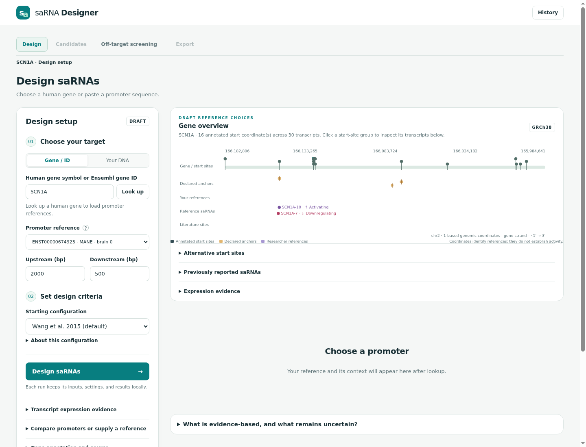
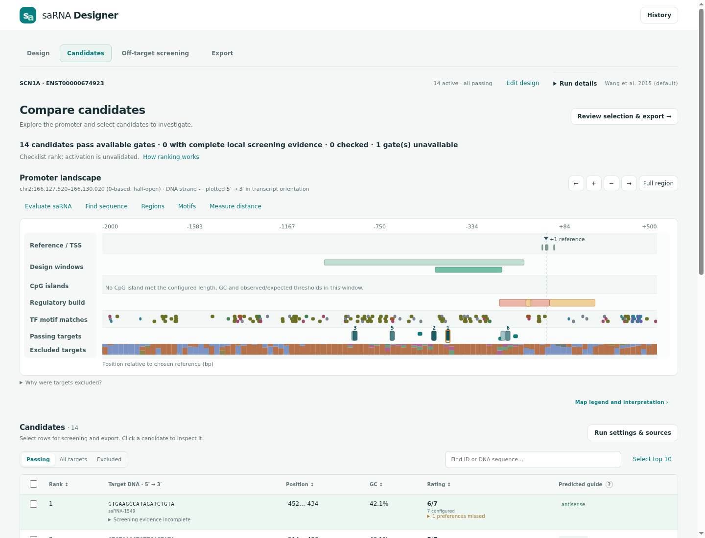
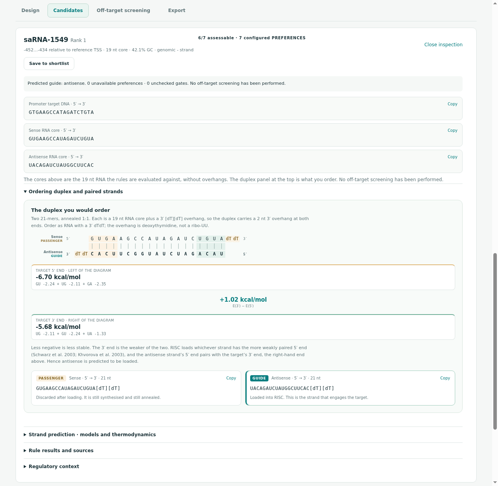
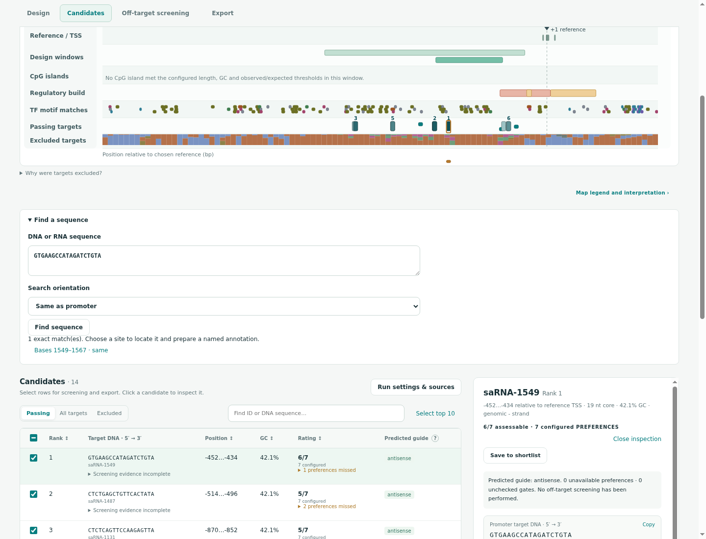
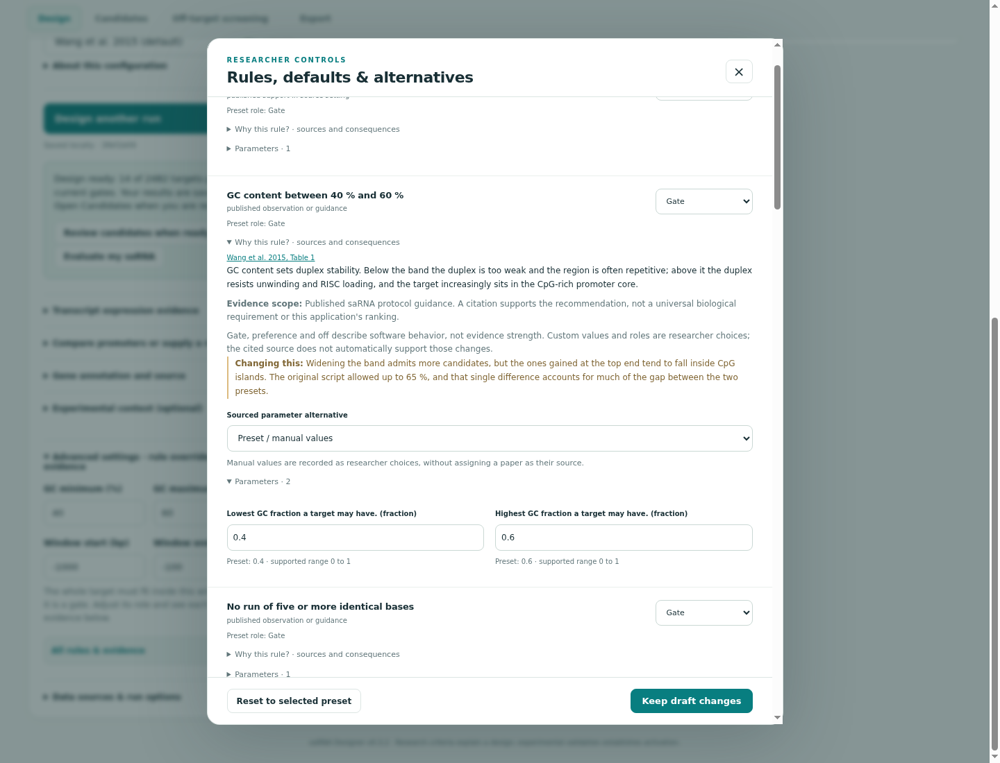
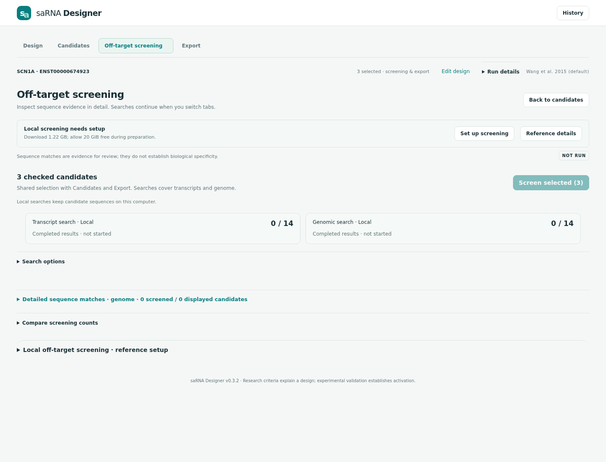
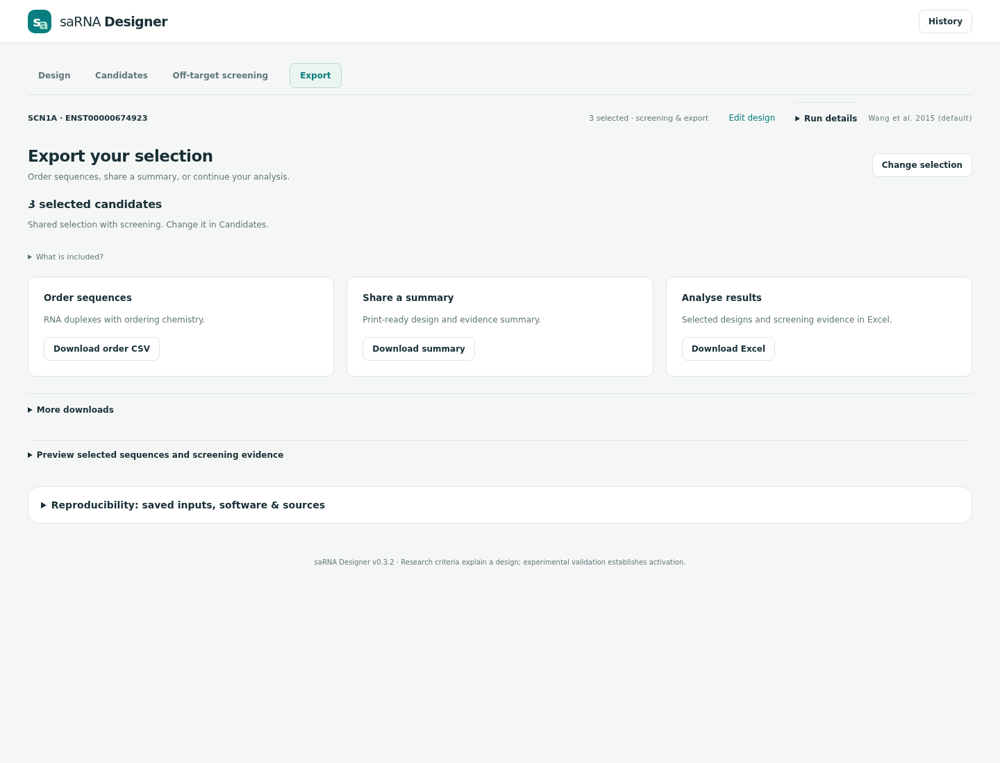

# Application screenshots

These are fresh browser captures of saRNA Designer v0.3.2, taken on 2 November 2026.
They show the current four-workspace interface using a real SCN1A promoter from cached
Ensembl data. Select an image to open it at its original resolution.

No off-target screening was submitted for this gallery. Empty screening status is deliberate;
these images do not contain scripted screening results or experimental activation measurements.

## Design setup

[](design-setup.png)

Choose a gene or paste promoter DNA, select the reference and configuration, then run the
design. Expression evidence, alternative references and rule settings open separately.
The screenshot uses transcript ENST00000674923 and the default Wang 2015 configuration.

## Promoter map and candidate list

[](promoter-landscape.png)

The 2,500 bp promoter window produces 2,482 candidate targets; 14 pass the available gates.
The map retains excluded targets and shows the reference TSS, design windows, three Ensembl
regulatory features and 144 predicted motif matches. Motif and regulatory tracks are enabled
in this capture. Neither track establishes TF occupancy or activity in a particular cell type.

Map tools provide existing saRNA evaluation, sequence search, saved regions, motif selection
and distance measurements. The candidate list is visible without opening a separate section.

## Candidate and duplex inspection

[](duplex-inspection.png)

The highest-ranked candidate is saRNA-1549, at positions -452 to -434 relative to the selected
reference. The expanded ordering section shows both strands, 3′ dTdT overhangs and modelled
terminal energies. The antisense guide assignment is a thermodynamic prediction, not measured
strand loading. Rules, model comparisons and regulatory context remain available on demand.

## Sequence search

[](sequence-search.png)

This view searches for the target DNA of saRNA-1549 in the loaded promoter. Search supports
DNA or RNA and explicit orientation. Matches refer to the loaded window; a missing match does
not establish absence elsewhere in the genome. Regions can be named and saved with citations.

## Design rules and sources

[](design-rules.png)

Each rule separates its software role from its scientific evidence. Sources, rationale and
parameter values open separately. The GC-content explanation is expanded here; no rule role
or parameter was changed for these captures.

## Off-target screening workspace

[](screening-workspace.png)

The active selection is shared with Candidates and Export. Local setup shows download and
disk requirements before installation. Engine and batch settings, alignments and methods
open separately. This screenshot shows an unscreened selection, not a specificity result.

## Export choices

[](export-options.png)

Three candidates are checked for this view. The main choices are ordering CSV, a printable
design summary and an Excel workbook. More downloads include promoter alignment HTML,
coordinate CSV, screening summaries, figures and complete run archives. The sequence preview
opens separately. The summary HTML can be printed to PDF from a browser.

## Capture provenance

- App version: **0.3.2**. Source baseline: [`d9d5079`](https://github.com/JoepVondervoort/sarna-designer/commit/d9d5079664f773139234f162d9ca86fffb34ac5f).
- Capture date: **2 November 2026**, Europe/Amsterdam.
- Browser: Chrome for Testing **150.0.7871.24**, headless.
- Viewport: **1440 × 1100 CSS pixels**, with device scale factor 1. The duplex inspection
  uses the responsive stacked layout at **1280 × 1250** so the complete paired-strand diagram fits.
- Input: cached SCN1A gene, transcript, promoter and regulatory records from Ensembl.
- Reference: **ENST00000674923**, GRCh38 chromosome 2, interval **166,127,520 to 166,130,020**
  in zero-based, half-open coordinates, oriented to the minus-strand transcript.
- Configuration: Wang 2015 defaults, 2,000 bp upstream and 500 bp downstream. Motif and
  regulatory annotations enabled, five motif background shuffles, no chromatin tracks.
- No off-target searches, reference downloads or experimental measurements were performed.
- All PNGs are direct browser captures. They have not been composited or retouched.
- [Machine-readable capture details](capture.json) record the run, coordinates, settings,
  counts, browser, viewport and source revision. Counts are specific to that saved input.

## Recreate the gallery

From the repository root, with Chromium and the same cached SCN1A reference responses:

```bash
.venv/bin/python scripts/capture_documentation_screenshots.py \
  --chrome /path/to/chrome
```

The capture script starts an isolated local app, uses cache-only lookups, and writes images
and `capture.json` to this directory. It verifies that the configuration is unchanged and
that no off-target searches were submitted. It does not modify your saved runs.
A newer reference cache can change coordinates, annotations or candidate counts.

For the separate functional browser checks:

```bash
.venv/bin/python scripts/verify_workbench_browser.py \
  --chrome /path/to/chrome --gene SCN1A --screenshots out/browser-check
```

That test suite includes scripted screening fixtures. Its screening figures should not be
presented as biological results. The documentation capture script uses the normal app service
and does not use those fixtures.
