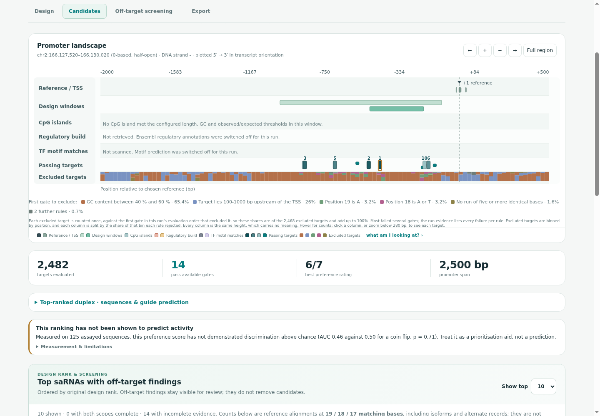
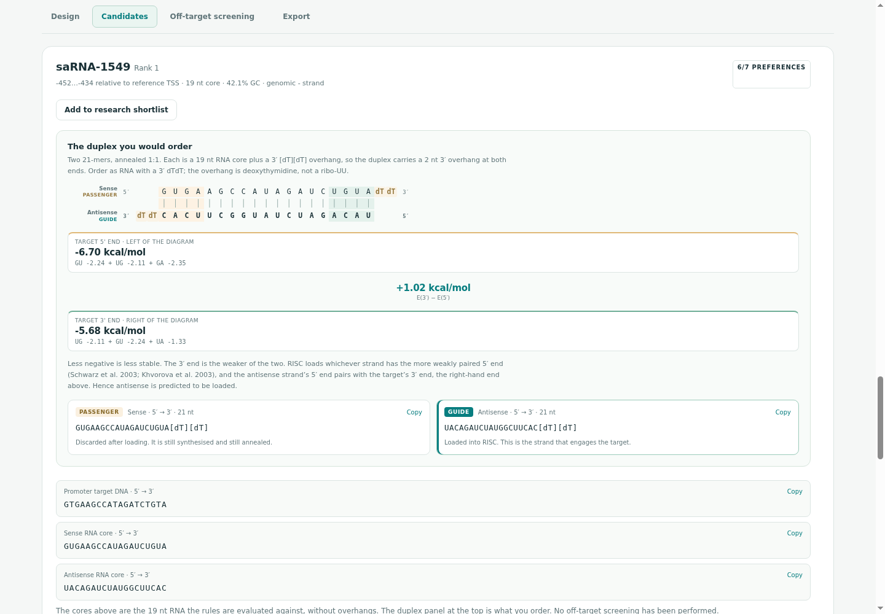
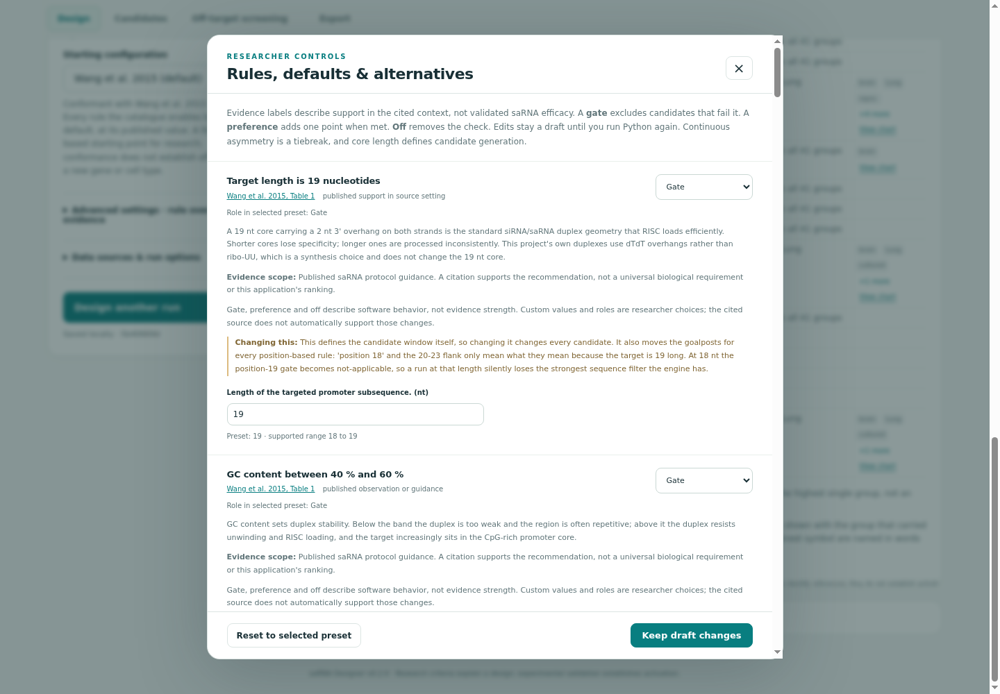

# Application screenshots

These images document the running saRNA Designer workbench. They are stored with the source
under `docs/assets/screenshots/` so README links work on GitHub and in a local checkout.
Select an image below to open it at its original resolution.

## Promoter landscape

[](promoter-landscape.png)

The default Wang 2015 configuration evaluates 2,482 targets in a 2,500 bp SCN1A promoter
window; 14 pass the available gates. The map shows the reference TSS, design windows,
passing targets and binned exclusions. Optional motif scanning and regulatory retrieval were
switched off; those tracks say so. The screen also states the ranking's validation limits.

## Duplex inspection

[](duplex-inspection.png)

The highest-ranked candidate in this run is saRNA-1549, at −452…−434 relative to the selected
reference. Its RNA duplex is shown antiparallel, with dTdT overhangs and modelled terminal
energies. The antisense guide assignment is a thermodynamic prediction, not measured loading.
No off-target screening was performed for this screenshot run.

## Design rules and sources

[](design-rules.png)

The settings dialog separates a rule's software role from its scientific evidence.
Published recommendations, parameter choices and consequences of changing a setting are visible.
Opening the editor did not change the default configuration used for these screenshots.

## Capture provenance

- Captured on 18 October 2026 from the local app in Chrome for Testing 150.0.7871.24, headless, at 1440 × 1000 pixels.
- Application source baseline: `fb22e98`, with the presentation and type-check corrections in
  the accompanying commit. The PNGs are browser captures, without compositing or image retouching.
- Input: cached Ensembl SCN1A gene, transcript and promoter responses; Wang 2015 defaults.
  These are real reference sequences, not a synthetic promoter or experimental readout.
- The cached reference identifies GRCh38 chromosome 2, interval 166,127,520–166,130,020
  (0-based, half-open), oriented to the minus-strand transcript.
- Screenshots do not establish activation, specificity or experimental suitability.
  Counts are specific to this saved input and configuration.

To recreate these views, start the app, look up SCN1A using the same cached inputs, leave
Wang 2015 defaults selected, disable optional motif and regulatory retrieval, then run the design.
In **Candidates**, expand the promoter context for the landscape, then expand **All candidates &
detailed inspection** and inspect the top candidate. In **Design**, open the rule editor.
Use a 1440 × 1000 browser viewport and scroll each panel below the sticky navigation.
A newer annotation response may change the reference selection or counts.

For the broader automated browser verification (including separate, scripted screening
fixtures), run from the repository root:

```bash
.venv/bin/python scripts/verify_workbench_browser.py \
  --chrome /path/to/chrome --gene SCN1A --screenshots out/browser-check
```

That check needs cached SCN1A responses, or explicit online retrieval with `--online`.
Its screening figures are interface test fixtures and should not be presented as biological
screening results. The three images in this directory use an unscreened default design run.
